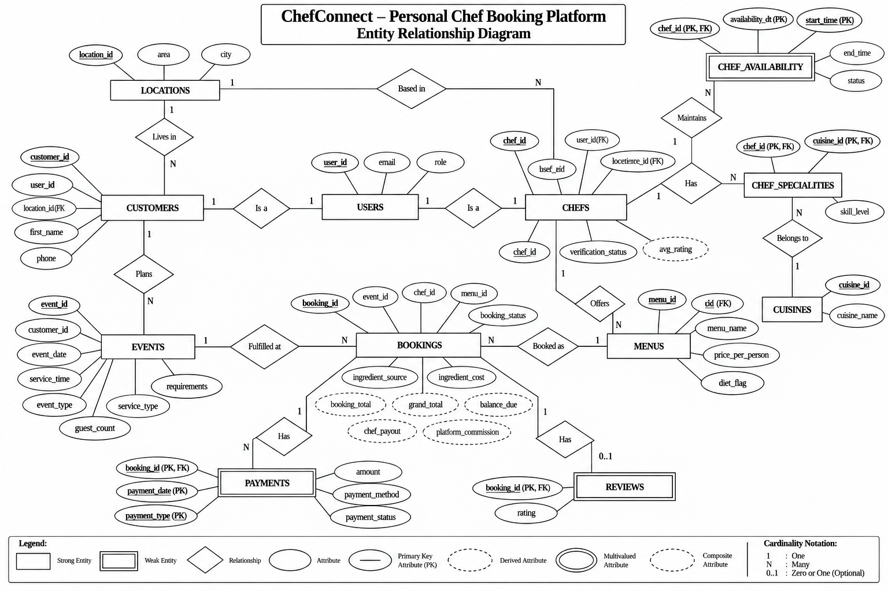

# ChefConnect 🍳 Personal Chef Booking Platform — SQL Data Analysis Project

# 📌 Project Overview

ChefConnect is a MySQL-based database project that models a platform where customers plan events (birthdays, weddings, corporate lunches) and book verified personal chefs and their menus.

The project stores information about:

  Users, customers and chefs
  Locations
  Cuisines and chef specialities
  Chef availability
  Menus
  Events and bookings (main table)
  Payments and reviews

The main purpose of this project is to practice SQL database design, relationships, data retrieval, aggregation, joins, subqueries and advanced analysis using a realistic marketplace scenario.

# 🎯 Objectives

  Design a relational database in MySQL (12 tables).
  Establish Primary Key, Foreign Key, Unique and Composite Key constraints.
  Insert realistic chef-booking data.
  Retrieve and filter data using SQL.
  Analyse revenue, bookings, chef performance and customer behaviour.
  Practice the basic commands: SELECT, WHERE, INSERT, UPDATE, DELETE, ALTER, RENAME and DROP.
  Practice JOINs and aggregate functions (COUNT, SUM, AVG, MIN, MAX) with GROUP BY and HAVING.
  Apply subqueries, views, stored procedures, triggers, a stored function and transactions.

# 🗄️ Database Structure

Database name: chefconnect_db

The project contains 12 tables:

Table                : Purpose

locations            : Area and city (composite address)
users                : Login identity and role (admin / customer / chef)
customers            : Customer profile (derived from users)
chefs                : Chef profile and verification status (derived from users)
cuisines             : Cuisine master list
chef_specialities    : Chef <-> cuisine mapping with skill level (many-to-many junction, composite key)
chef_availability    : Dates and time ranges a chef can work (weak entity of chefs, composite key)
menus                : Menus offered by a chef with price per person
events               : Customer's occasion or home-cooking request (service type, date, time, guests)
bookings             : MAIN TABLE - a chef + menu booked for an event or a home meal, with ingredient source
payments             : Payments for a booking: service charge or ingredient reimbursement (weak entity of bookings)
reviews              : Customer rating for a booking (one review per booking, key = booking_id)

Removed as unnecessary (not needed for the booking flow, or derivable): chef_documents (chefs.verification_status
is enough), chef_payouts (payout = 85% of the booking total, so it is a derived value), support_tickets (not part
of the booking and revenue flow), and the unused columns cuisines.category, locations.latitude/longitude,
chef_availability.available_slots, bookings.distance_km / cancelled_at / cancel_amount.

# 🍽️ Hiring Options: Event or Personal Chef

When a customer hires a chef there are two choices.

1. Service type (events.service_type, with event_date and service_time)
   Event          : the chef cooks for an occasion (party, wedding, corporate lunch)
   Personal Chef  : the chef comes to the customer's HOME at a specific date and time and cooks a fresh, healthy
                    meal, so the customer needs no delivery app and no restaurant visit.

2. Ingredient source (bookings.ingredient_source and bookings.ingredient_cost)
   Customer : the chef cooks with the ingredients already present at the house (ingredient_cost = 0)
   Chef     : the chef fetches the ingredients; the customer pays the bill as a separate payment with
              payments.payment_type = 'Ingredients' and the chef is reimbursed in full.

Both options work for either service type. A CHECK rule makes sure ingredient_cost is 0 whenever the customer
provides the ingredients. Ingredient payments are pass-through reimbursements, so all revenue queries count only
payment_type = 'Service'. Commands M11 - M18 in Main_Table_Relations.txt show these options in action.

# ⭐ Main Table: BOOKINGS

BOOKINGS is the only table that joins the customer side (events), the chef side (chefs) and the menu side (menus),
and PAYMENTS and REVIEWS depend on it. One booking_id reaches every other table.
See Main_Table_Relations.txt for the relation map and 18 ready-to-run commands (M1 - M18) with their results.

  EVENTS      bookings.event_id = events.event_id      -> service type, event type, date, time, guests, requirements
  CUSTOMERS   via events.customer_id                   -> who booked
  LOCATIONS   via customers / chefs location_id        -> customer city, chef city
  CHEFS       bookings.chef_id = chefs.chef_id         -> chef name, experience
  MENUS       bookings.menu_id = menus.menu_id         -> menu, diet type, price per person
  PAYMENTS    payments.booking_id = bookings.booking_id-> amount, method, status, type (Service / Ingredients)
  REVIEWS     reviews.booking_id = bookings.booking_id -> rating

The composite foreign key (menu_id, chef_id) -> menus(menu_id, chef_id) guarantees that the menu of a booking
always belongs to the booked chef.

# 🔢 Auto-Increment Keys (AI)

A key is AUTO_INCREMENT only when it is a system-generated number that other tables point to.
These 8 keys are AUTO_INCREMENT: location_id, user_id, customer_id, chef_id, cuisine_id, menu_id, event_id, booking_id.
Keys made of other columns are never AUTO_INCREMENT:
chef_specialities (chef_id + cuisine_id), chef_availability (chef_id + availability_dt + start_time),
payments (booking_id + payment_date + payment_type) and reviews (booking_id).
An id nobody references (such as the old availability_id, payment_id and review_id) was removed as unnecessary.

# 🔗 Database Relationships

ER model concepts used in the diagram:

Entities
  Strong entity   : USERS, CUSTOMERS, CHEFS, LOCATIONS, CUISINES, MENUS, EVENTS, BOOKINGS (main table),
                    CHEF_SPECIALITIES (associative entity: key = chef_id + cuisine_id, both foreign keys)
  Weak entity     : CHEF_AVAILABILITY (owner CHEFS, partial keys availability_dt + start_time)
                    PAYMENTS (owner BOOKINGS, partial keys payment_date + payment_type)
                    REVIEWS (owner BOOKINGS, no partial key: the key is booking_id alone)
                    Drawn as a double rectangle. They have no number of their own: the primary key is
                    owner FK + partial key(s)
                    (availability: chef_id + availability_dt + start_time,
                    payments: booking_id + payment_date + payment_type,
                    reviews: booking_id).

Attributes
  Key attribute         : primary keys (PK, bold and underlined); also FK and UK markers
  Location address      : kept as two columns, area and city
  Multi-part attribute  : EVENTS.requirements (an event can have many requirements; stored in one TEXT column)
  Derived attribute     : CHEFS.avg_rating, BOOKINGS.booking_total, BOOKINGS.grand_total, BOOKINGS.balance_due,
                          BOOKINGS.chef_payout, BOOKINGS.platform_commission (dashed ovals in the diagram;
                          calculated in queries, never stored. The views chef_avg_rating and
                          booking_financials return them ready-made)

Relationships
  One to One   : USERS - CUSTOMERS, USERS - CHEFS
  One to Zero-or-One : BOOKINGS - REVIEWS (a booking has at most one review: 0..1)
  One to Many  : CUSTOMERS - EVENTS, CHEFS - MENUS, CHEFS - BOOKINGS, EVENTS - BOOKINGS, MENUS - BOOKINGS,
                 BOOKINGS - PAYMENTS, CHEFS - CHEF_AVAILABILITY
  Many to One  : CUSTOMERS - LOCATIONS, CHEFS - LOCATIONS
  Many to Many : CHEFS - CUISINES, shown in the diagram through the entity CHEF_SPECIALITIES
                 (CHEFS 1:N CHEF_SPECIALITIES, CUISINES 1:N CHEF_SPECIALITIES, attribute skill_level)

Main tables and their derived tables:

  USERS ──1:1──► CUSTOMERS, CHEFS
  LOCATIONS ──1:N──► CUSTOMERS, CHEFS
  CUSTOMERS ──1:N──► EVENTS
  CUISINES ──1:N──► CHEF_SPECIALITIES
  CHEFS ──1:N──► CHEF_SPECIALITIES, CHEF_AVAILABILITY, MENUS, BOOKINGS
  MENUS ──1:N──► BOOKINGS
  EVENTS ──1:N──► BOOKINGS
  BOOKINGS ──1:N──► PAYMENTS
  BOOKINGS ──1:1──► REVIEWS

# Primary relationships (Foreign Keys)

customers.user_id            → users.user_id
customers.location_id        → locations.location_id
chefs.user_id                → users.user_id
chefs.location_id            → locations.location_id
chef_specialities.chef_id    → chefs.chef_id
chef_specialities.cuisine_id → cuisines.cuisine_id
chef_availability.chef_id    → chefs.chef_id
menus.chef_id                → chefs.chef_id
events.customer_id           → customers.customer_id
bookings.event_id            → events.event_id
bookings.chef_id             → chefs.chef_id
bookings.(menu_id, chef_id)  → menus.(menu_id, chef_id)
payments.booking_id          → bookings.booking_id
reviews.booking_id           → bookings.booking_id   (also the primary key)

# 🛠️ Technologies Used

Database: MySQL 8.0+
Language: SQL
Tool: MySQL Workbench / MySQL CLI
Database Type: Relational Database

# 📂 Table Details

1. locations — location_id, area, city.
2. users — user_id, email (unique), role.
3. customers — customer_id, user_id, location_id, first_name, phone.
4. chefs — chef_id, chef_name, user_id, location_id, experience_years, verification_status.
5. cuisines — cuisine_id, cuisine_name.
6. chef_specialities — chef_id, cuisine_id, skill_level.
7. chef_availability — chef_id, availability_dt, start_time, end_time, status. Primary key: (chef_id, availability_dt, start_time).
8. menus — menu_id, chef_id, menu_name, price_per_person, diet_flag.
9. events — event_id, customer_id, event_date, service_time, event_type, service_type (Event / Personal Chef), guest_count, requirements.
10. bookings — booking_id, event_id, chef_id, menu_id, booking_status, ingredient_source (Customer / Chef), ingredient_cost.
11. payments — booking_id, payment_date, payment_method, payment_status, payment_type (Service / Ingredients), amount. Primary key: (booking_id, payment_date, payment_type).
12. reviews — booking_id (primary key and foreign key: one review per booking), rating (1 to 5).

Views (not tables):
  booking_financials — booking_total, grand_total, balance_due, chef_payout, platform_commission of every booking
  chef_avg_rating    — average rating of every chef
  (created in Database_Creation_Insertion.txt)

  Created by Hard_queries.txt (Q81 - Q84):
  v_booking_details, v_chef_scorecard, v_monthly_revenue

Helper table (created by Hard_queries.txt, Q92): booking_status_log - audit rows written by a trigger.
It is not part of the 12 core tables.

Derived values (calculated in queries, never stored):
  booking_total = menus.price_per_person x events.guest_count          (the service charge)
  grand_total   = booking_total + bookings.ingredient_cost
  balance_due   = booking_total - successful 'Service' payments
  chef_payout   = booking_total x 0.85 (+ ingredient_cost, reimbursed in full)
  platform commission = booking_total x 0.15

# 📊 SQL Analysis Performed

The project contains 100 SQL practice and analysis queries in three levels.

# 🟢 Simple Queries (Q1 – Q40)

Q1  – Q14   SELECT * on every table and SELECT of chosen columns
Q15 – Q27   WHERE with AND, OR, NOT IN, LIKE, BETWEEN and IN
Q28 – Q31   ORDER BY, LIMIT and DISTINCT
Q32 – Q40   Data commands on a practice copy of the menus table (the real tables are never changed):
            CREATE TABLE ... AS SELECT, INSERT, UPDATE, DELETE, ALTER TABLE ADD COLUMN,
            RENAME COLUMN, RENAME TABLE, DROP TABLE, SHOW TABLES

# 🟡 Medium Queries (Q41 – Q70)

Q41 – Q46   Aggregate functions: COUNT, SUM, AVG, MAX, MIN
Q47 – Q53   INNER JOIN (two, three and four tables)
Q54 – Q58   LEFT JOIN, RIGHT JOIN, SELF JOIN and CROSS JOIN
Q59 – Q66   GROUP BY and HAVING with joins and aggregate functions
Q67 – Q70   Business analysis: booking value, commission, chef payout, monthly revenue

# 🔴 Hard Queries (Q71 – Q100)

Q71 – Q80   Subqueries: scalar, MAX, IN, NOT IN, EXISTS, NOT EXISTS, HAVING with a subquery,
            subquery in the SELECT list
Q81 – Q84   Views: v_booking_details, v_chef_scorecard, v_monthly_revenue
            (built on the existing views booking_financials and chef_avg_rating)
Q85 – Q91   Stored procedures with IN / OUT parameters: sp_chef_bookings, sp_customer_statement,
            sp_monthly_revenue, sp_available_chefs, sp_create_booking, sp_record_payment, sp_cancel_booking
Q92 – Q97   Triggers: booking status audit log, booking status flow rules, verified-chef rule,
            chef slot blocking, payment validation, review only after a Completed booking
Q98 – Q100  Other: CASE expression, stored function fn_booking_total, transaction with SAVEPOINT

# 💼 Business Questions Answered

Which chef earns the highest payout?
Which chefs have no bookings?
Which menu is booked most often?
Which customers have never planned an event?
Which bookings still have an outstanding balance?
Which payment method brings the most revenue?
What is the monthly revenue and its growth?
Which city generates the highest revenue?
What is each chef's rating, cancellation rate and payout?
Who is the top-spending customer in each city?
Which upcoming events still have pending payments?
What is the full story (customer, chef, menu, payments, rating) of one booking?
How many bookings are home-cooked Personal Chef meals versus Events?
Which bookings need the chef to buy the ingredients, and has the customer paid them back?
Which verified chefs in my city are free on a given date for a home meal?

# 🚀 How to Run the Project

Step 1 — Install MySQL Server (8.0+) and MySQL Workbench.

Step 2 — Open a new SQL tab in MySQL Workbench.

Step 3 — Run Database_Creation_Insertion.txt. It creates the database, all 12 tables in dependency order, inserts the data and creates 2 views.

  locations → users → customers → chefs → cuisines → chef_specialities → chef_availability → menus → events → bookings → payments → reviews

Step 4 — Verify:

USE chefconnect_db;
SHOW TABLES;

Step 5 — Run the analysis queries progressively (Hard_queries.txt creates views, procedures, triggers and a function, so run it
as a whole script in MySQL Workbench; it uses DELIMITER $$ for them. Simple_queries.txt Q32 - Q40 create and drop a
practice table, so run that part in order):

Simple_queries.txt  → Q1 – Q40
Medium_queries.txt  → Q41 – Q70
Hard_queries.txt    → Q71 – Q100

Step 6 — Run Main_Table_Relations.txt to see how everything is fetched from the main table BOOKINGS.

Step 7 — Compare your results with Execution.txt.

# 📁 Project Structure

chefconnect-database-sql/
│
├── README.md
├── ER-Diagram.png
├── Database_Creation_Insertion.txt
├── Simple_queries.txt
├── Medium_queries.txt
├── Hard_queries.txt
├── Main_Table_Relations.txt
└── Execution.txt

# 🔮 Possible Future Improvements

Chef verification documents table
Chef payout records (date and status)
Support tickets for bookings
Menu items table with dish-level details
Cancellation fees and history
Payout and refund tables so cancellation refunds are stored instead of only calculated

# 👨‍💻 Project Summary

ChefConnect is a relational MySQL project that models a personal-chef marketplace. It connects users, customers, chefs, menus, events, bookings (the main table), payments and reviews, and moves from basic SQL to advanced analytical queries.

Project: ChefConnect Database SQL Data Analysis
Database: chefconnect_db
Tables: 12
Analysis Queries: 100
Difficulty Levels: Simple (basic commands) → Medium (joins and aggregates) → Hard (subqueries, views, procedures, triggers)
